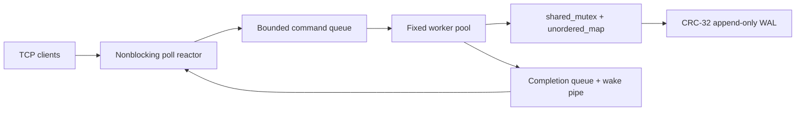

# ConcurrentKV

A working C++20 TCP key-value server built to explore storage-engine correctness, bounded concurrency, POSIX networking, and crash recovery. This is a production-inspired **single-node portfolio project**, with explicit durability contracts and executable tests.



- SET, GET, DELETE, EXISTS, STATS; persistent, fragmented, and pipelined connections.
- Socket I/O stays on the event loop; idle clients never occupy workers.
- Fixed worker count, bounded queue, per-connection request/idle limits and explicit overload behavior.
- Concurrent readers, ordered mutations, RAII descriptors, signal-safe shutdown notification.
- Versioned binary WAL, exclusive process lock, checksums, torn-tail repair and restart replay.
- CTest integration tests, ASan/UBSan and separate TSan configurations, reproducible load generator.
- Standard library and POSIX only: C++20, CMake, threads, sockets, shared_mutex, condition variables, atomics.

## Build and test

Requirements: CMake 3.16+, a C++20 compiler/standard library (GCC 11+ or recent Clang), POSIX Linux or macOS. On Debian/Ubuntu install `build-essential cmake`; on macOS install Xcode command-line tools and CMake.

```sh
cmake -S . -B build -DCMAKE_BUILD_TYPE=Release
cmake --build build -j4
ctest --test-dir build --output-on-failure
```

```sh
cmake -S . -B build-asan -DCMAKE_BUILD_TYPE=Debug -DENABLE_ASAN=ON
cmake --build build-asan -j4
ctest --test-dir build-asan --output-on-failure

cmake -S . -B build-tsan -DCMAKE_BUILD_TYPE=Debug -DENABLE_TSAN=ON
cmake --build build-tsan -j4
ctest --test-dir build-tsan --output-on-failure
```

Sanitizer support depends on the compiler/OS runtime. Use separate build directories; ASan and TSan cannot be combined. Tests use checks that remain enabled in Release builds. GitHub Actions includes Linux/macOS configurations; a workflow file is not evidence that remote CI has executed.

## Run

```sh
mkdir -p data
./build/kv_server --bind 127.0.0.1 --port 8080 --workers 4 --queue 1024 \
  --max-connections 1024 --max-requests 1000000 --idle-seconds 30 \
  --wal data/concurrentkv.wal --durability sync
```

In another terminal:

```sh
./build/kv_client 127.0.0.1 8080
```

```text
SET user:101 Vikas
OK
GET user:101
VALUE Vikas
EXISTS user:101
EXISTS 1
DELETE user:101
OK
GET user:101
NOT_FOUND
STATS
STATS accepted=... active=... requests=... successful=... failed=... get=... set=... delete=... keys=... queue_depth=... queue_capacity=... rejected=... uptime_s=... avg_latency_us=...
```

The client accepts stdin, so `printf 'SET greeting hello world\nGET greeting\n' | ./build/kv_client` also works. Stop the server with Ctrl-C or SIGTERM, restart with the same WAL, and GET previously written keys. `./build/kv_server --help` lists options. Numeric IPv4 bind addresses are supported; the client resolves IPv4 hostnames. The client has five-second socket I/O timeouts.

Protocol: LF only, case-sensitive ASCII, 256-byte keys without spaces, values up to 7900 bytes including spaces or empty values, 8192-byte command limit. `SET empty ` stores an empty value. No escaping. See [the full protocol](docs/protocol.md) for error responses, backpressure, framing limits, and statistics semantics.

## Concurrency and persistence

One reactor owns sockets and bounded per-client buffers. At most one operation per client enters a fixed-size worker pool. A full queue returns `ERR BUSY`; excess connections close immediately. The same connection's commands and responses remain ordered. Readers take shared map locks; writers hold an exclusive lock across WAL append and map update, preserving replay order. Responses use incremental sends; a wake pipe reports worker completions.

Default `sync` durability acknowledges effective mutations only after successful fsync. `shutdown` durability appends without per-write sync and flushes on orderly shutdown; acknowledged writes can be lost after a machine crash. Errors can leave an uncertain mutation outcome, so failed WALs reject further mutations. Complete checksum-corrupt records stop recovery; incomplete trailing records are truncated. See [WAL format and guarantees](docs/design_decisions.md) and [architecture](docs/architecture.md).

SIGINT/SIGTERM stops acceptance and submission, drains admitted tasks, flushes storage, then attempts completion responses plus `ERR SHUTDOWN` for up to two seconds. Unsubmitted buffered commands are discarded. A blocked filesystem operation can extend shutdown.

## Benchmark

With the server running:

```sh
./build/kv_bench --host 127.0.0.1 --port 8080 --connections 8 \
  --requests 2000 --warmup 100 --keys 1000 --value-size 64 --set-percent 20
```

Requests/warmup are **per connection**. The generator preloads keys, runs warmup, synchronizes measured workers, and reports attempted/successful requests per second plus average/p50/p95/p99 latency separately for successful and failed requests. Seeds are fixed at 42 + connection index. Keys use the `bench:` namespace; use an isolated WAL for measurements. Read hits must return the expected value. Failed connections/responses are counted as failures; a failed run exits nonzero. See [actual measurements and methodology](docs/performance.md).

Local Release smoke measurements (Apple M3, 8 GB RAM, 8 connections, 80% GET/20% SET, 64-byte values, median of three 16000-request runs):

| Durability | Successful requests/s | p99 latency | Failed requests |
| --- | ---: | ---: | ---: |
| sync | 25,188.7 | 1.184 ms | 0 |
| shutdown | 31,963.0 | 0.941 ms | 0 |

All six CTest suites passed locally in Release, ASan/UBSan, and TSan builds. These short loopback runs have substantial variance; they are not production capacity claims. Full configurations and individual samples are in the linked performance report.

## Docker

```sh
docker compose up --build -d
docker compose logs -f
docker compose down
```

Multistage Debian build runs CTest, then installs the server/client into a non-root runtime image. Compose binds the published port to localhost and uses a named volume for WAL persistence. Health checks execute STATS. The server is PID 1 via exec-form ENTRYPOINT and receives SIGTERM directly. `docker compose down -v` **deletes persistent data**. Docker runtime validation status is recorded in [verification](docs/verification.md).

## Tests and limits

Six suites cover command correctness/errors, concurrent readers/writers and replay ordering, deterministic queue saturation/drain, WAL locking/corruption/truncated headers and bodies, network framing/pipelining/limits/half-closes, kernel short writes/EAGAIN/disconnects, idle-client starvation, SIGINT/SIGTERM shutdown, and SIGKILL/restart recovery. Process-crash tests verify acknowledged writes under `sync`; they do not simulate power loss or failing hardware. See [verification](docs/verification.md) for actual local results.

Known limits: poll scans all connections; writes serialize under one lock and synchronous fsync; memory and WAL growth are unbounded; there is no compaction, authentication, TLS, transactions, TTL, replication, or consensus. Keep loopback binding or deploy behind an authenticated private boundary. A single machine's loopback result is not a production capacity claim.

## Distributed roadmap

Future work starts with snapshots/compaction and log sequence numbers, then integrates a tested Raft implementation for durable term/vote/log state, leader election, quorum commitment, failure detection, failover, membership changes, snapshot transfer, and replication recovery. These features are **not implemented**. [Design decisions](docs/design_decisions.md) describes the milestones without presenting local WAL persistence as distributed consensus.
