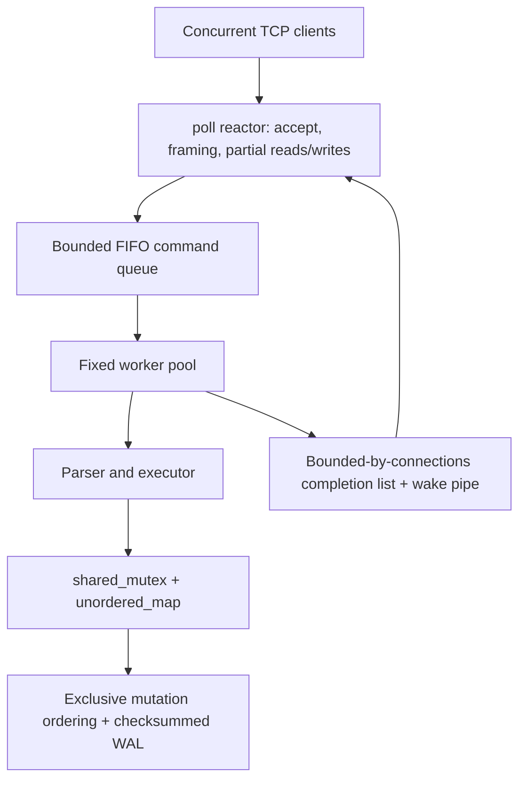

# Architecture

One reactor owns every server socket and connection buffer. Sockets are nonblocking. Workers never wait for network I/O. A client can have at most one command queued/running, preventing response reordering and bounding completion memory by the connection cap. A nonblocking pipe wakes the reactor when a worker finishes. Pipe saturation is harmless: a pending byte already guarantees a wakeup, and the protected completion list holds the actual responses. Stable, monotonically increasing connection IDs prevent an old completion from targeting a recycled descriptor. Clients that stall output cannot accumulate unlimited responses.

The reactor uses poll for Linux/macOS portability. Its descriptor scan is O(connections); epoll/kqueue becomes worthwhile at substantially higher connection counts. A 50 ms poll timeout bounds signal/stop responsiveness while pipe wakeups keep command latency independent of that timeout. Admission overload rejects commands or closes excess sockets. Limit admission at the OS/container level too when deploying into untrusted environments.

All map access holds a shared or exclusive lock. Reads return owned copies. Writers retain the exclusive lock across WAL append/sync and map modification, establishing the same mutation order in memory and on replay. SET allocates its replacement and map node before appending; the final swap is nonthrowing. Failed appends roll back a newly inserted placeholder. Deletes log before erasing. Missing-key deletes are no-ops and need no log. Synchronous I/O serializes writes, intentionally favoring an easily defended correctness model over maximum write throughput.

Main's signal handler only stores to a compile-time-verified lock-free atomic boolean, which is safe even when the signal arrives on a worker thread. The reactor stops admission, closes the listener, drains the pool, gathers completions, flushes the WAL, attempts response delivery for two seconds, closes clients, and joins all workers. No detached threads. Exceptions also unwind RAII sockets and join workers. A shutdown flush failure exits nonzero and cannot promise successful durability. Disk I/O has no hard deadline: a hung fsync can delay shutdown.

The thread pool must be shut down from its owner thread, not a worker, and its tasks must contain exceptions. Application command tasks convert storage exceptions into protocol errors. Catastrophic allocation failures are outside the recoverable service contract.
